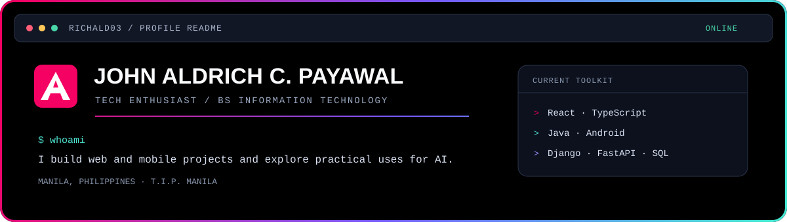

  

  <a href="https://payawal-readme.vercel.app"><strong>PORTFOLIO</strong></a>
  &nbsp;·&nbsp;
  <a href="mailto:aldrichpayawal3@gmail.com">EMAIL</a>
  &nbsp;·&nbsp;
  <a href="https://www.linkedin.com/in/john-aldrich-payawal-9378b8427/">LINKEDIN</a>

<code>BS Information Technology · T.I.P. Manila · Manila, Philippines</code>

## Hi, I’m John Aldrich C. Payawal

I’m an IT student and tech enthusiast who enjoys building web and mobile apps and using AI to refine ideas, solve problems, and improve my work.

## Selected work

<table>
  <tr>
    <td width="50%" valign="top">
      
      <h3>MATYAG</h3>
      
Cross-platform disaster reporting and hazard-awareness project for the T.I.P. Manila CCS community.

      
React · TypeScript · FastAPI · PostgreSQL

      <a href="https://payawal-readme.vercel.app/#portfolio">View project →</a>
    </td>
    <td width="50%" valign="top">
      
      <h3>BrightTrack LMS</h3>
      
School learning platform with role-based academic workflows and student-support features.

      
Django · PostgreSQL · Tailwind CSS · Gemini API

      <a href="https://github.com/haruto-web/campus-care-project">View repository →</a>
    </td>
  </tr>
  <tr>
    <td width="50%" valign="top">
      
      <h3>PhishSwish</h3>
      
Android app for checking suspicious messages and links through camera, SMS, and pasted-text scans.

      
Java · Android · ML Kit · Firebase

      <a href="https://github.com/richald03/PhishSwish">View repository →</a>
    </td>
    <td width="50%" valign="top">
      
      <h3>SeekyFind</h3>
      
Campus lost-and-found Android app for reporting and searching for missing or found items.

      
Java · Android · Firebase

      <a href="https://payawal-readme.vercel.app/#portfolio">View project →</a>
    </td>
  </tr>
  <tr>
    <td width="50%" valign="top">
      
      <h3>MapaBaha</h3>
      
Flood-focused weather and community reporting web app; contributor.

      
Laravel · React

      <a href="https://payawal-readme.vercel.app/#portfolio">View project →</a>
    </td>
    <td width="50%" valign="top">
      
      <h3>Camera E-commerce Website</h3>
      
Camera storefront created on Shopify for a client.

      
Shopify

      <a href="https://payawal-readme.vercel.app/#portfolio">View project →</a>
    </td>
  </tr>
</table>

## Toolkit

  <strong>Languages</strong> 
  Python · Java · C++ · PHP · JavaScript · TypeScript · SQL

  <strong>Web &amp; mobile</strong> 
  React · Django · Flask · FastAPI · Laravel · Tailwind CSS · Android Studio

  <strong>Data &amp; tools</strong> 
  PostgreSQL · MongoDB Atlas · Firebase · SQLite · Git · Docker · Shopify · AWS S3 · Amazon EC2

  <a href="https://payawal-readme.vercel.app">Explore the full portfolio</a>
  &nbsp;·&nbsp;
  <a href="mailto:aldrichpayawal3@gmail.com">Get in touch</a>

